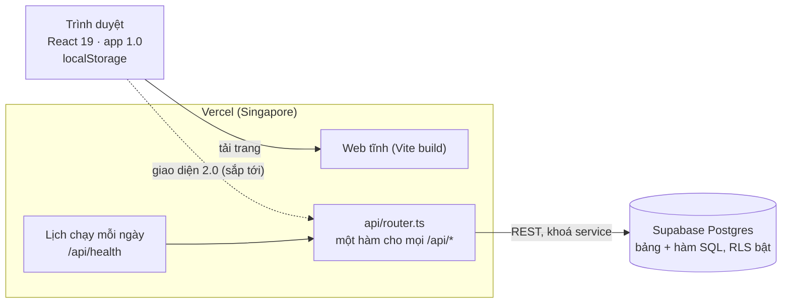

# ClinicHIS — Quản lý phòng khám Nhi Khoa

[](https://github.com/ico-231/clinichis/actions/workflows/ci.yml)

Phần mềm quản lý phòng khám ngoại trú, dựng cho portfolio. Có đủ một ngày làm việc của phòng khám:
tiếp nhận, khám, chỉ định cận lâm sàng, kê đơn, thu tiền, bệnh án điện tử và báo cáo. Giao diện tiếng Việt,
thương hiệu riêng **ClinicHIS / Phòng khám Nhi Khoa**.

**Bản chạy thật:** <https://clinichis-ico18.vercel.app>. Mở là dùng được ngay, không cần đăng nhập.

> ⚠️ Đây là bản demo. Đừng nhập dữ liệu y tế hay thông tin cá nhân thật. Ô mật khẩu chỉ để minh hoạ, không lưu lại.
> Thanh toán, hoá đơn điện tử và gửi đơn thuốc đều là mô phỏng.


| Tổng quan | Màn khám |
| --- | --- |
|  |  |


## Có gì trong dự án

- **Ứng dụng web (bản 1.0):** 13 mục trên menu, khoảng 24 màn. Chạy hoàn toàn trên trình duyệt, dữ liệu lưu ở
  `localStorage`. Lần đầu mở, mỗi trình duyệt tự tạo dữ liệu mẫu theo đúng ngày hôm đó.
- **API (backend):** 18 đường dẫn REST cho người bệnh, lượt khám, khám bệnh, cận lâm sàng, thu tiền, danh mục,
  cài đặt và báo cáo. Chạy trên Vercel Functions, dữ liệu nằm ở Supabase (Postgres). Mọi quy tắc nghiệp vụ được
  kiểm ở máy chủ: không nhảy cóc trạng thái, không xoá hồ sơ đã khám, số thứ tự và số phiếu không trùng khi
  nhiều quầy thao tác cùng lúc. App 1.0 **chưa** gọi API; API để dành cho giao diện 2.0.
- **Dữ liệu demo trên máy chủ:** có sẵn từ 7 ngày trước tới 60 ngày sau. Ngày nào cũng như một ngày đang làm việc
  (18 lượt khám, đủ các trạng thái).

## Kiến trúc



- **Frontend:** React 19, TypeScript, Vite, Tailwind CSS 4, lucide-react. Không dùng thư viện UI, biểu đồ hay router:
  thành phần giao diện tự viết trong `src/components/ui`, biểu đồ là SVG tự vẽ. State nằm trong một store React Context
  + `useReducer` (`src/store/`). Màn Lễ tân tải sẵn, các màn khác tải khi cần (`React.lazy`).
- **Giao diện:** nền ấm, xanh ngọc làm màu chính, cam san hô làm điểm nhấn, font Be Vietnam Pro. Mọi màu đi qua token
  trong `src/index.css` (`bg-surface`, `text-ink-3`, `bg-brand`…), không viết mã màu trong component, nên giao diện sáng
  và tối đổi đồng bộ trên mọi màn, kể cả biểu đồ. Menu ngang trên cùng, màn hẹp hơn 1024px chuyển thành ngăn kéo.
- **Backend:** handler chuẩn Web `Request`/`Response` trong `server/routes/`. Gói Hobby của Vercel giới hạn 12 hàm nên
  mọi đường dẫn đi qua một hàm duy nhất (`api/router.ts`). Nghiệp vụ dùng chung với frontend (`src/store/`) nên
  hai bên không lệch nhau. Gọi Supabase bằng `fetch` tới PostgREST, không cần thư viện. Việc cần chạy trọn trong một
  giao dịch (cấp mã bệnh nhân, tăng bộ đếm, thay danh mục) viết thành hàm SQL.
- **Bảo vệ API:** khoá dùng chung `x-clinic-key` cho bản demo (không thay được đăng nhập), giới hạn lượt gọi theo IP,
  kiểm dữ liệu vào và trả lỗi rõ ràng (400/401/404/409/422/429). Ngày tháng tính theo giờ Việt Nam dù máy chủ chạy UTC.
- Chi tiết: [docs/BACKEND.md](docs/BACKEND.md) (danh sách API), [docs/DEPLOY.md](docs/DEPLOY.md) (triển khai, biến môi trường).

## Chạy trên máy

Cần Node 20.19+ (đã thử với Node 22 và 24). Dự án dùng pnpm; máy chưa cài pnpm thì gọi qua `npx`:

```bash
npx -y pnpm@10.34.3 install
npx -y pnpm@10.34.3 dev
```

| Lệnh | Việc |
| --- | --- |
| `pnpm dev` | Chạy app ở chế độ phát triển |
| `pnpm build` | Build production vào `dist/` |
| `pnpm test` | Chạy toàn bộ test (Vitest) |
| `pnpm e2e` | Bấm thử trên trình duyệt (Playwright, dùng Google Chrome đã cài trên máy; tự build và chạy ở cổng 4174) |
| `pnpm exec tsc -b --noEmit` | Kiểm tra kiểu cho cả frontend lẫn máy chủ |

App chạy được ngay, không cần backend. Muốn chạy cả API thì xem [docs/DEPLOY.md](docs/DEPLOY.md) và [env.example](env.example).
Đặt `CLINIC_DATA=memory` để API dùng dữ liệu trong bộ nhớ, khỏi cần Supabase.

**Đặt lại dữ liệu mẫu của app:** xoá khoá `clinic-his:state` trong localStorage rồi tải lại trang.

## Tính năng theo màn hình

| Màn | Nội dung chính |
| --- | --- |
| **Tổng quan** | Thẻ doanh thu, biểu đồ lượt khám theo ngày, tỉ lệ người bệnh mới/cũ, thông báo, checklist kích hoạt |
| **Lễ tân** | Danh sách lượt khám theo ngày; lọc theo trạng thái, thanh toán và lọc nâng cao; tiếp nhận bệnh cũ (tìm nhanh) và bệnh mới; chỉ định CLS; thu tiền; in phiếu tiếp nhận; đổi trạng thái ngay trên dòng |
| **Khám bệnh** | Hàng chờ và lịch sử bệnh; sinh hiệu, BMI; hỏi bệnh; chỉ định CLS và xem kết quả; chẩn đoán ICD-10; kê đơn (đơn mẫu có hộp quản lý đổi tên/xoá, tự tính số lượng); hẹn tái khám; ghi chú; thu tiền; in đơn thuốc, phiếu chỉ định |
| **Cận lâm sàng** | Chẩn đoán hình ảnh (soạn mô tả và kết luận, chụp webcam, tải ảnh, mẫu kết quả); Xét nghiệm (tải tệp PDF hoặc ảnh); báo cáo doanh thu CLS; thiết lập danh mục dịch vụ và mẫu kết quả |
| **Người bệnh** | Danh sách; thêm, sửa, xoá; hồ sơ kèm lịch sử khám và ghi chú; ngăn chi tiết lượt khám 4 tab |
| **Bệnh án điện tử** | Danh sách; bệnh án, phiếu điều trị, tổng kết; ký; bản in bệnh án ngoại trú; nhật ký truy cập |
| **Lịch hẹn, Lịch làm việc** | Lịch cố định, nghỉ và linh hoạt, xem theo tuần hoặc tháng |
| **Báo cáo** | Tổng quan, doanh thu bán hàng, chẩn đoán ICD, dịch vụ chưa thu, hoá đơn, khám bệnh, sổ khám bệnh, lịch sử tải về; xuất CSV |
| **Hệ thống** | Thông tin phòng khám, tài khoản, giao diện sáng/tối/theo hệ thống, cài đặt chung (tiền tố mã, lab mặc định), cơ cấu tổ chức, tiền công khám, nhân viên, nhật ký bệnh án |

Mọi thao tác đều làm bằng nút, không cần nhớ phím tắt.

## Chất lượng

- **Kiểm thử:** gần 140 test Vitest. Có luồng nghiệp vụ đầu-cuối chạy trên store thật (tiếp nhận → khám → chỉ định CLS →
  thu tiền → huỷ, hoàn tiền), và test cho từng API: kiểm dữ liệu, chuyển trạng thái, thu tiền, phân trang Supabase, giờ VN.
  Thêm 12 test Playwright bấm thử trên Chrome thật ([e2e/](e2e)): mở đủ 13 màn không lỗi, menu ngăn kéo ở màn hẹp, tiếp nhận người
  bệnh mới (và còn sau khi tải lại), chặn bỏ trống trường bắt buộc, khám → chẩn đoán ICD → kê thuốc → hoàn thành, thu tiền,
  đổi tên / xoá đơn mẫu, dùng menu và bảng bằng bàn phím.
- **Tự kiểm tra trên GitHub:** mỗi lần push, CI chạy kiểm tra kiểu, test, build và test trình duyệt ([.github/workflows/ci.yml](.github/workflows/ci.yml)).
- **An toàn dữ liệu:** không xoá được hồ sơ đã có bệnh án hoặc phiếu thu; chỉ định đã thu tiền hay đã làm thì không xoá được;
  bệnh án đã ký bị khoá; cảnh báo trùng hồ sơ khi tạo người bệnh mới; lỗi ở một màn không làm trắng cả ứng dụng.
- **Truy cập:** hộp thoại giữ focus bàn phím và trả focus khi đóng; ô nhập có nhãn cho trình đọc màn hình; lỗi nhập liệu
  được đọc lên; có link "Bỏ qua menu"; tôn trọng chế độ giảm chuyển động; tương phản màu đạt WCAG AA ở cả nền sáng và tối.
- **Nhiều cỡ màn hình:** tối ưu cho máy tính từ 1280px, dùng tốt từ 1024px; điện thoại vẫn dùng được (menu và hàng chờ
  khám thành ngăn kéo, bảng cuộn ngang và ghim cột Trạng thái, Mã KB).
- **Bảo mật:** CSV xuất ra chống chèn công thức Excel; nội dung định dạng (kết quả CĐHA) được làm sạch trước khi hiển thị;
  khoá Supabase chỉ nằm ở máy chủ; bảng dữ liệu bật RLS và hàm SQL không mở cho khách.

## Phạm vi

- **Có ảnh tham chiếu thì làm, không có thì không.** Một số mục còn là trang chờ: Đối soát thanh toán, Báo cáo khám mới, cài đặt Hoá đơn điện tử, tab Phân loại và Combo trong thiết lập CLS.
- **Loại trừ theo yêu cầu:** Nhà thuốc, Tin tức, Học CME, Tư vấn trực tuyến, hồ sơ bác sĩ công khai, Phát triển thương hiệu.
- Ảnh tham chiếu (`docs/reference/screenshots/`) không được commit vì là ảnh của bên thứ ba. Ảnh trong README do dự án tự chụp.

## Tài liệu

- [docs/ROADMAP.md](docs/ROADMAP.md): lộ trình theo giai đoạn và trạng thái từng hạng mục
- [docs/BACKEND.md](docs/BACKEND.md): thiết kế backend, danh sách API
- [docs/DEPLOY.md](docs/DEPLOY.md): đưa lên Supabase + Vercel, dữ liệu demo, lịch chạy
- [docs/reference/INDEX.md](docs/reference/INDEX.md): danh mục ảnh tham chiếu theo module
